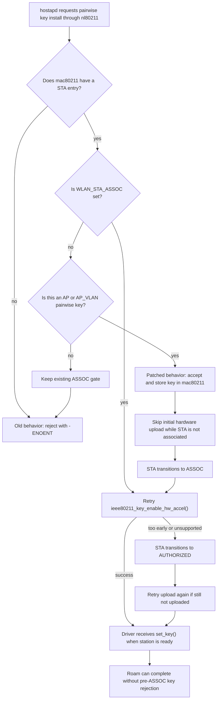
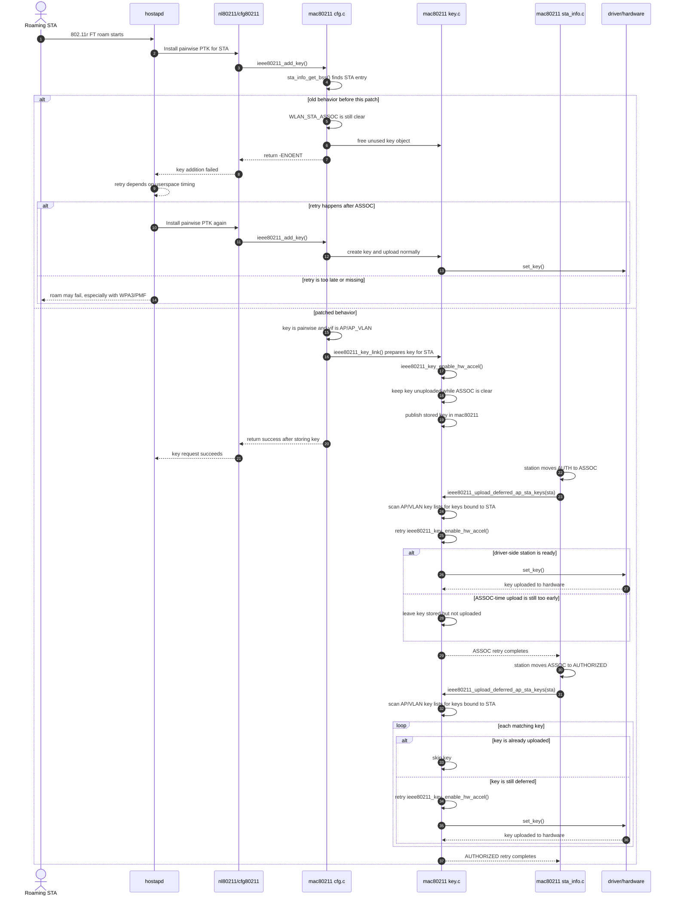
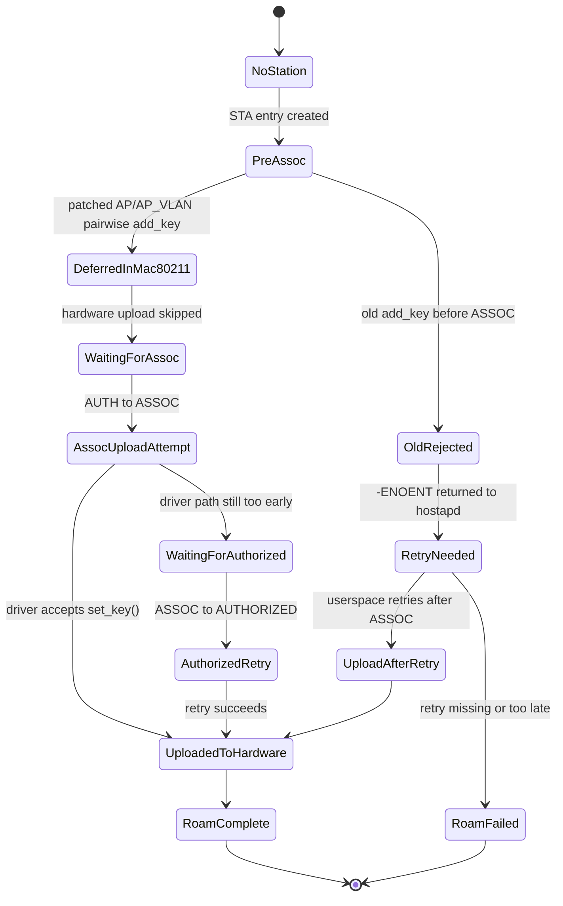

# AP-side 802.11r FT key upload race

This note explains the mac80211 side of the problem addressed by
`patches/subsys/390-mac80211-defer-ap-side-ft-key-upload.patch` and the
OpenWrt PR at <https://github.com/openwrt/openwrt/pull/23181>. The repository
also carries a companion hostapd patch for the related FT-over-DS/WDS path where
userspace must re-add an unassociated kernel STA before the first PTK install.

As checked on 2026-05-19, that upstream PR is open and scoped to one mac80211
patch file:
`package/kernel/mac80211/patches/subsys/390-mac80211-defer-ap-side-ft-key-upload.patch`.
The patch is currently proposed as an OpenWrt-local mac80211 fix, not as a
backport of an already accepted linux-wireless commit.

## Short version

During AP-side 802.11r Fast Transition, hostapd can ask the kernel to install a
pairwise PTK after mac80211 has a station object but before mac80211 has marked
that station associated.

Before the patch, `ieee80211_add_key()` rejected that request because
`WLAN_STA_ASSOC` was not set yet. The rejection returned `-ENOENT` to nl80211,
which hostapd reported as:

```text
nl80211: kernel reports: key addition failed
```

That was often recoverable with WPA2 because userspace could retry after
association completed. With WPA3/PMF, the timing is tighter, and the same
pre-association rejection can break the roam rather than just producing a noisy
log line.

The patch changes the policy for one narrow case:

- the key must be pairwise;
- the interface must be AP or AP_VLAN;
- a station entry must already exist;
- if the station is not associated yet, the key is accepted into mac80211 but
  not uploaded to the driver yet.

Once the station reaches ASSOC, mac80211 retries hardware upload. The later
AUTHORIZED transition is kept as a second retry point.

## Why the old behavior existed

The old `WLAN_STA_ASSOC` gate was not arbitrary. It protected drivers from
receiving per-station keys before the driver-side station state was ready for
those keys.

In other words, the old check traded a userspace-visible failure for a safer
driver contract:

1. If there was no station entry, reject the key.
2. If there was a station entry but it was not associated, reject the key.
3. Rely on userspace to retry key installation after association.

That made sense for client-side FT retry behavior and for drivers that only
accept keys after the station is associated. The old in-code TODO already
described the better long-term shape: accept the key when a station entry exists
and add it to the device after the station becomes ready.

This patch implements that TODO for the AP-side pairwise FT case while keeping
the old rejection behavior for everything else.

## Actors and states

The main pieces involved are:

- `hostapd`: derives or receives the AP-side FT pairwise key and asks the kernel
  to install it through nl80211.
- `nl80211/cfg80211`: transports the key installation request into mac80211.
- `net/mac80211/cfg.c`: receives the key request in `ieee80211_add_key()`.
- `net/mac80211/key.c`: owns key objects and hardware acceleration upload
  through `ieee80211_key_enable_hw_accel()`.
- `net/mac80211/sta_info.c`: drives station state transitions, including
  AUTH to ASSOC and ASSOC to AUTHORIZED.
- the driver and hardware: receive keys only when mac80211 decides the station
  and key are ready for hardware upload.

The important station milestones are:

- station entry exists: mac80211 can attach a key object to a known STA;
- ASSOC: mac80211 considers the STA associated and the driver should be ready
  for the normal per-station key upload path;
- AUTHORIZED: the STA is allowed to pass controlled-port traffic, and the patch
  uses this later transition as a backup retry point.

## Flowchart



## Sequence diagram



## State machine



## What changed in the patch

### `net/mac80211/cfg.c`

`ieee80211_add_key()` now computes:

```c
defer_pairwise_ap =
	pairwise &&
	(sdata->vif.type == NL80211_IFTYPE_AP ||
	 sdata->vif.type == NL80211_IFTYPE_AP_VLAN);
```

The rejection rule becomes:

```c
if (!sta ||
    (!test_sta_flag(sta, WLAN_STA_ASSOC) &&
     !defer_pairwise_ap)) {
	ieee80211_key_free_unused(key);
	return -ENOENT;
}
```

That means:

- no station entry still fails;
- non-AP pre-ASSOC keys still fail;
- non-pairwise pre-ASSOC keys still fail;
- AP/AP_VLAN pairwise keys are allowed once a STA entry exists, even if
  `WLAN_STA_ASSOC` is not set yet.

This is the central race fix. It removes the premature `-ENOENT` only for the
case that AP-side FT needs.

### `net/mac80211/key.c`

The patch adds an AP-side pairwise guard inside
`ieee80211_key_enable_hw_accel()`:

```c
pairwise_ap = sta && (key->conf.flags & IEEE80211_KEY_FLAG_PAIRWISE) &&
	      (sdata->vif.type == NL80211_IFTYPE_AP ||
	       sdata->vif.type == NL80211_IFTYPE_AP_VLAN);

if (pairwise_ap && !test_sta_flag(sta, WLAN_STA_ASSOC)) {
	ret = 1;
	goto out_unsupported;
}
```

This matters because accepting the key into mac80211 is not the same as sending
it to hardware immediately.

The `ret = 1` assignment is intentional. Some drivers, including ath10k, set
`IEEE80211_HW_SW_CRYPTO_CONTROL`, which means mac80211 must not automatically
fall back to software crypto after hardware upload is skipped. In mac80211's
`set_key()` contract, a return value of `1` means this specific key can stay in
software. Setting `ret = 1` for the pre-ASSOC deferral therefore lets the key be
accepted and validated while still avoiding premature driver upload. Without
that value, the deferred path can still fail for `SW_CRYPTO_CONTROL` drivers.

The `pairwise_ap` filter intentionally mirrors the narrower exception in
`cfg.c`. The add-key path accepts a pre-ASSOC key only for AP/AP_VLAN pairwise
keys, so the upload path should defer hardware programming only for that same
case. Without this matching scope, a generic pairwise-key deferral in
`ieee80211_key_enable_hw_accel()` could silently change non-AP reupload paths
such as station, mesh, or IBSS key reenablement, even though those paths were not
part of the AP-side FT race.

Without this second guard, the patch would risk moving the old failure from
`cfg.c` into the driver. Some drivers are not ready to receive the pairwise key
until the station has reached the associated state. The fix therefore splits the
operation:

1. accept and retain the key object early;
2. defer driver upload until the station state is ready.

The same file also adds:

- `ieee80211_upload_keys_for_sta()`;
- `ieee80211_upload_deferred_ap_sta_keys()`.

The helper walks the interface key list and retries hardware upload for keys
that:

- are bound to the target `sta`;
- are not already marked `KEY_FLAG_UPLOADED_TO_HARDWARE`.

The retry deliberately calls `ieee80211_key_enable_hw_accel()` again rather than
duplicating readiness checks. That keeps the existing checks for unsupported
hardware crypto, missing driver support, and `sta->uploaded` in one place.

### AP_VLAN handling

The PR review called out that AP_VLAN key placement is subtle. A key can be
attached through an AP_VLAN device while the station relationship may also
involve the master AP interface.

The final local patch handles that by checking both sides:

- when called from a master AP, it walks the AP key list and each configured
  VLAN key list;
- when called from an AP_VLAN, it walks the VLAN key list and then the master
  AP key list;
- for other interface types, it returns without scanning key lists.

That avoids relying on only `sta->sdata->key_list`, which could miss a deferred
key object stored on the related AP or VLAN interface.

### `net/mac80211/key.h`

The patch exposes:

```c
void ieee80211_upload_deferred_ap_sta_keys(struct sta_info *sta);
```

This lets the station-state code call the retry helper at the right lifecycle
points while keeping non-AP station transitions out of the deferred-key scan.

### `net/mac80211/sta_info.c`

The patch adds two retry calls in `_sta_info_move_state()`:

```c
/* Primary retry for AP key uploads deferred until ASSOC. */
ieee80211_upload_deferred_ap_sta_keys(sta);
```

at the AUTH to ASSOC transition, and:

```c
/* Extra retry if the ASSOC-time AP key upload was too early. */
ieee80211_upload_deferred_ap_sta_keys(sta);
```

at the ASSOC to AUTHORIZED transition.

The first call is the intended primary upload point. The second call is
idempotent for keys already uploaded because the helper skips
`KEY_FLAG_UPLOADED_TO_HARDWARE`. It exists so a key that could not be uploaded
at ASSOC still gets another chance as the station reaches the fully authorized
state.

## Why this is not the naive workaround

A naive workaround would remove the `WLAN_STA_ASSOC` check and accept all early
keys. That is too broad for three reasons.

First, it would affect STA, mesh, IBSS, and other non-AP paths even though the
reported OpenWrt problem is AP-side FT roaming.

Second, it could upload a key to drivers before the station is in the state
where those drivers expect per-station keys.

Third, it could leave behavior dependent on incidental retry paths such as
hardware restart or key reenablement rather than tying the retry to the station
lifecycle.

This patch is narrower:

- early acceptance is limited to AP/AP_VLAN pairwise keys;
- early hardware upload is blocked until ASSOC;
- upload retries are attached to explicit station transitions;
- non-AP and non-pairwise behavior keeps the old gate.

## Failure modes before the patch

### Visible symptom

The visible symptom is a hostapd log entry:

```text
nl80211: kernel reports: key addition failed
```

The immediate kernel-side cause is `ieee80211_add_key()` returning `-ENOENT`
because `WLAN_STA_ASSOC` is still clear.

### WPA2 impact

With WPA2, the failure may be mostly harmless. Userspace commonly retries after
association, so the roam can still finish. The user still gets noisy logs and
potentially slower or less deterministic roaming.

### WPA3/PMF impact

With WPA3 and PMF, the same timing window is less forgiving. The roam depends
on completing protected state transitions promptly, and a rejected pairwise key
install can break the roam instead of only adding a log line.

### Driver-contract risk

The old ASSOC check also encoded a real driver-contract concern: do not send a
key to the driver before the driver-side station is ready. The fix must
therefore avoid simply moving the rejection from mac80211 into driver `set_key()`
handling.

## Review-driven constraints captured by the patch

The PR discussion raised several design constraints that are reflected in the
current mac80211 patch:

- OpenWrt-local status should be explicit because an out-of-tree mac80211 patch
  can bitrot against future kernel backports.
- The hardware-upload skip must be scoped to AP/AP_VLAN pairwise keys, matching
  the relaxation in `cfg.c`.
- The pre-ASSOC skip must happen before the generic `sta && !sta->uploaded`
  path and set `ret = 1`, so drivers with `SW_CRYPTO_CONTROL` can keep the key
  in software until the later ASSOC retry.
- The station-state retry helper is explicitly AP/AP_VLAN-scoped, so the generic
  `_sta_info_move_state()` transitions do not make non-AP stations scan key
  lists.
- Upload retry should not have an outer silent `!sta->uploaded` return. The
  existing `ieee80211_key_enable_hw_accel()` helper already owns that check.
- AP_VLAN setups need both the VLAN and master AP key lists considered.
- The AUTH to ASSOC and ASSOC to AUTHORIZED retry calls need comments because
  the second call is intentionally a backup retry, not accidental duplication.

## Validation noted in the PR

The PR description reports validation on two Filogic OpenWrt APs:

- Cudy WR3000P v1;
- Cudy WR3000E v1.

The reported validation was:

- reproduce the issue during 802.11r FT roaming;
- flash patched images;
- repeat bidirectional FT roams;
- observe no new `nl80211: kernel reports: key addition failed` log entries on
  either AP.

The PR discussion also notes one remaining caveat: a dedicated AP_VLAN plus FT
roam test had not yet been run when the AP_VLAN review concern was addressed.

Additional forum testing reported that an earlier revision cleared the log on
mt76 but still produced `nl80211: kernel reports: key addition failed` on
ath10k. The current revision was updated after that report by moving the
pre-ASSOC AP/AP_VLAN pairwise deferral before the generic `sta && !sta->uploaded`
check and by setting `ret = 1` for the deferred path. That change is intended to
cover ath10k's `SW_CRYPTO_CONTROL` behavior, but a successful ath10k retest of
the latest revision has not yet been reported.

## Practical result

After the patch, AP-side FT key installation no longer depends on userspace
winning a retry race after ASSOC. mac80211 accepts the key at the first point
where it has enough identity to store it safely, then uploads it to the driver
when the station lifecycle reaches the correct point.

The intended result is:

- no premature `-ENOENT` for AP-side FT pairwise keys;
- no premature driver key upload before ASSOC;
- preserved behavior for non-AP and non-pairwise keys;
- deterministic retry tied to station state transitions;
- a fallback retry at AUTHORIZED for edge timing cases.

## References

- Local mac80211 patch: `../../patches/subsys/390-mac80211-defer-ap-side-ft-key-upload.patch`
- Companion hostapd patch: `../../patches/hostapd/022-hostapd-ft-readd-unassociated-sta-before-ptk.patch`
- OpenWrt PR: <https://github.com/openwrt/openwrt/pull/23181>
- Historical mac80211 FT behavior discussion: <https://www.spinics.net/lists/kernel/msg1478599.html>
- OpenWrt forum report of the same hostapd log: <https://forum.openwrt.org/t/daemon-err-hostapd-nl80211-kernel-reports-key-addition-failed-is-this-a-problem/100370?page=2>
- OpenWrt forum ath10k report: <https://forum.openwrt.org/t/daemon-err-hostapd-nl80211-kernel-reports-key-addition-failed-is-this-a-problem/100370/93>
- OpenWrt forum follow-up on the ath10k-targeted revision: <https://forum.openwrt.org/t/daemon-err-hostapd-nl80211-kernel-reports-key-addition-failed-is-this-a-problem/100370/94>
