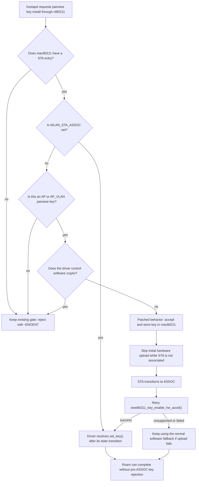
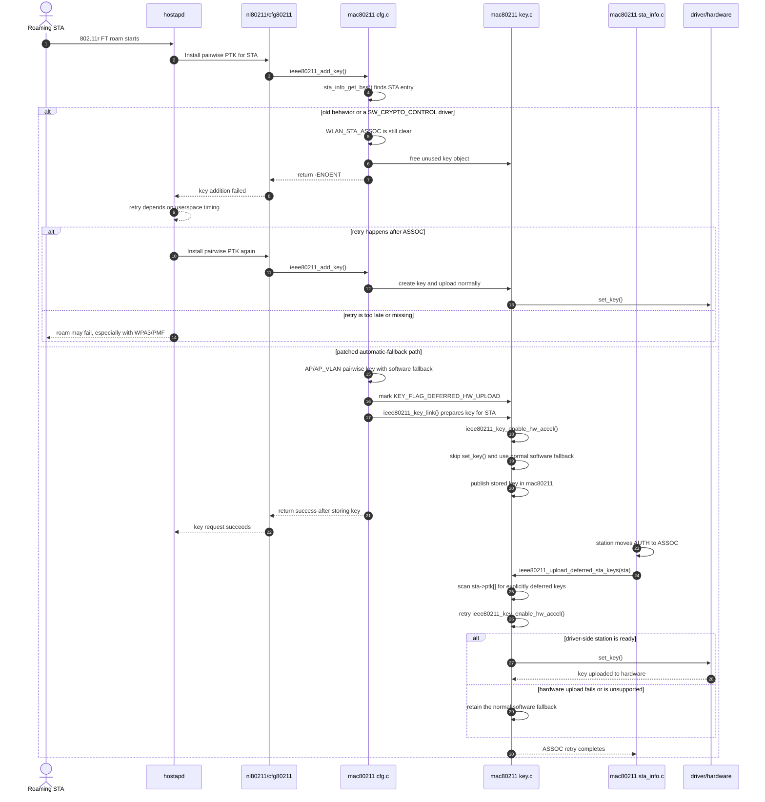
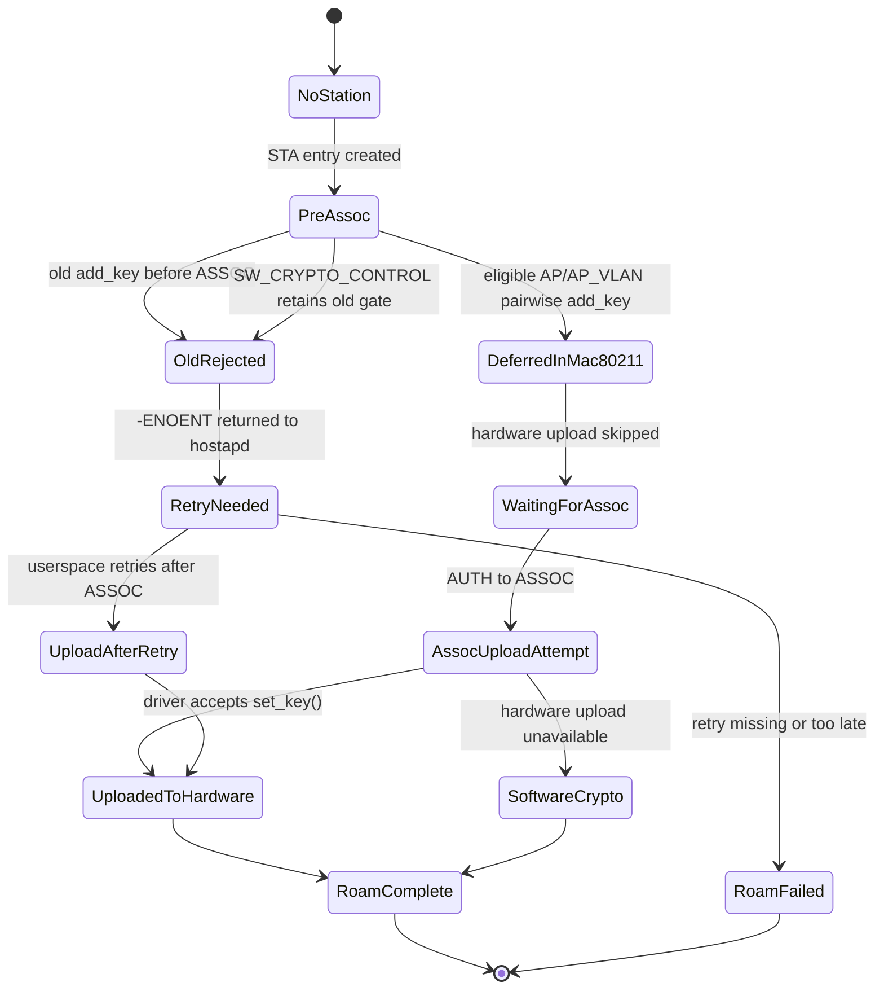

# AP-side 802.11r FT key upload race

This note explains the mac80211 side of the problem addressed by
`patches/subsys/400-mac80211-defer-ap-side-ft-key-upload.patch` and the
OpenWrt PR at <https://github.com/openwrt/openwrt/pull/23181>. The repository
also carries a companion hostapd patch for the related FT-over-DS/WDS path where
userspace must re-add an unassociated kernel STA before the first PTK install.

The OpenWrt copy remains an out-of-tree patch. An upstream version was posted
to linux-wireless in July 2026 and is being refined following maintainer review;
it has not been accepted into wireless-next.

## Short version

During AP-side 802.11r Fast Transition, hostapd can ask the kernel to install a
pairwise PTK after mac80211 has a station object but before mac80211 has marked
that station associated.

Before the patch, `ieee80211_add_key()` rejected that request because
`WLAN_STA_ASSOC` was not set yet. The rejection returned `-ENOENT` to nl80211,
which hostapd reported as:

```text
nl80211: kernel reports: key addition failed
```

That was often recoverable with WPA2 because userspace could retry after
association completed. With WPA3/PMF, the timing is tighter, and the same
pre-association rejection can break the roam rather than just producing a noisy
log line.

The patch changes the policy for one narrow case:

- the key must be pairwise;
- the interface must be AP or AP_VLAN;
- a station entry must already exist;
- the driver must allow mac80211's automatic software-crypto fallback;
- if the station is not associated yet, the key is accepted into mac80211 but
  not uploaded to the driver yet.

Once the driver's AUTH-to-ASSOC transition succeeds, mac80211 retries hardware
upload. Drivers advertising `IEEE80211_HW_SW_CRYPTO_CONTROL` keep the original
pre-association rejection because only their real `set_key()` return value can
permit software crypto.

## Why the old behavior existed

The old `WLAN_STA_ASSOC` gate was not arbitrary. It protected drivers from
receiving per-station keys before the driver-side station state was ready for
those keys.

In other words, the old check traded a userspace-visible failure for a safer
driver contract:

1. If there was no station entry, reject the key.
2. If there was a station entry but it was not associated, reject the key.
3. Rely on userspace to retry key installation after association.

That made sense for client-side FT retry behavior and for drivers that only
accept keys after the station is associated. The old in-code TODO already
described the better long-term shape: accept the key when a station entry exists
and add it to the device after the station becomes ready.

This patch implements that TODO for the AP-side pairwise FT case when automatic
software fallback is permitted. It keeps the old rejection behavior for
`SW_CRYPTO_CONTROL` drivers and for all unrelated key paths.

## Actors and states

The main pieces involved are:

- `hostapd`: derives or receives the AP-side FT pairwise key and asks the kernel
  to install it through nl80211.
- `nl80211/cfg80211`: transports the key installation request into mac80211.
- `net/mac80211/cfg.c`: receives the key request in `ieee80211_add_key()`.
- `net/mac80211/key.c`: owns key objects and hardware acceleration upload
  through `ieee80211_key_enable_hw_accel()`.
- `net/mac80211/sta_info.c`: drives station state transitions, including
  AUTH to ASSOC and ASSOC to AUTHORIZED.
- the driver and hardware: receive keys only when mac80211 decides the station
  and key are ready for hardware upload.

The important station milestones are:

- station entry exists: mac80211 can attach a key object to a known STA;
- ASSOC: mac80211 considers the STA associated and the driver should be ready
  for the normal per-station key upload path.

## Flowchart



## Sequence diagram



## State machine



## What changed in the patch

### `net/mac80211/cfg.c`

`ieee80211_add_key()` now computes an explicit deferred-upload condition:

```c
defer_hw_upload =
	sta && pairwise &&
	!test_sta_flag(sta, WLAN_STA_ASSOC) &&
	(sdata->vif.type == NL80211_IFTYPE_AP ||
	 sdata->vif.type == NL80211_IFTYPE_AP_VLAN) &&
	!ieee80211_hw_check(&local->hw, SW_CRYPTO_CONTROL);
```

The rejection rule becomes:

```c
if (!sta ||
    (!test_sta_flag(sta, WLAN_STA_ASSOC) &&
     !defer_hw_upload)) {
	ieee80211_key_free_unused(key);
	return -ENOENT;
}
```

That means:

- no station entry still fails;
- non-AP pre-ASSOC keys still fail;
- non-pairwise pre-ASSOC keys still fail;
- `SW_CRYPTO_CONTROL` drivers retain the old pre-ASSOC rejection;
- other AP/AP_VLAN pairwise keys are allowed once a STA entry exists, even if
  `WLAN_STA_ASSOC` is not set yet, and receive
  `KEY_FLAG_DEFERRED_HW_UPLOAD`.

This is the central race fix. It removes the premature `-ENOENT` only for the
AP-side FT case where mac80211 is allowed to keep the key in software.

### `net/mac80211/key.c`

The add-key path records deferral on the individual key. The hardware helper
then checks that marker before calling the driver:

```c
if (key->flags & KEY_FLAG_DEFERRED_HW_UPLOAD) {
	/*
	 * Deferred keys allow automatic software fallback. Keep ret at
	 * -EOPNOTSUPP until the station is ready for hardware upload.
	 */
	goto out_unsupported;
}
```

This matters because accepting the key into mac80211 is not the same as sending
it to hardware immediately.

The helper deliberately leaves `ret` at `-EOPNOTSUPP`. For ciphers mac80211 can
handle, that follows the existing automatic software-fallback path. It does not
invent a driver return value of `1`, which would violate the
`SW_CRYPTO_CONTROL` contract. The `cfg.c` condition guarantees that only
drivers permitting automatic fallback can reach this deferred branch.

The fix therefore splits the operation:

1. accept and retain the key object early;
2. defer driver upload until the station state is ready.

The same file adds `ieee80211_upload_deferred_sta_keys()`. The helper scans only
the target station's PTK slots:

- it ignores empty slots and keys without `KEY_FLAG_DEFERRED_HW_UPLOAD`;
- it refreshes `RX_MGMT` and `SPP_AMSDU` from the association parameters,
  including clearing stale capability flags while preserving unrelated flags;
- it computes the final flags locally and publishes them with `WRITE_ONCE()`,
  avoiding a temporary cleared state visible to RX/TX readers;
- it clears the marker before retrying;
- it calls the normal `ieee80211_key_enable_hw_accel()` path once.

An upload that already succeeded cannot be repeated because successful keys
were never marked deferred. If the ASSOC-time driver call still cannot offload
the key, the normal software fallback remains in use.

### AP_VLAN handling

The acceptance condition covers both AP and AP_VLAN. The retry does not scan
interface key lists; pairwise keys attached to the station are stored in
`sta->ptk[]`, so the explicit per-key marker follows the key regardless of
whether it was added through the AP or its VLAN interface.

### `net/mac80211/key.h`

The patch adds the internal marker and exposes the retry helper:

```c
KEY_FLAG_DEFERRED_HW_UPLOAD = BIT(2);
void ieee80211_upload_deferred_sta_keys(struct sta_info *sta);
```

Only keys accepted through the narrow `cfg.c` exception receive the marker.

### `net/mac80211/sta_info.c`

The patch adds one retry call in `_sta_info_move_state()` during AUTH to ASSOC:

```c
ieee80211_upload_deferred_sta_keys(sta);
```

The driver callback for AUTH to ASSOC runs earlier in the function and may fail
the upward transition. The upload helper is reached only after that callback
succeeds, so the driver-side station is prepared before `set_key()` is retried.

## Why this is not the naive workaround

A naive workaround would remove the `WLAN_STA_ASSOC` check and accept all early
keys. That is too broad for three reasons.

First, it would affect STA, mesh, IBSS, and other non-AP paths even though the
reported OpenWrt problem is AP-side FT roaming.

Second, it could upload a key to drivers before the station is in the state
where those drivers expect per-station keys.

Third, it could leave behavior dependent on incidental retry paths such as
hardware restart or key reenablement rather than tying the retry to the station
lifecycle.

This patch is narrower:

- early acceptance is limited to AP/AP_VLAN pairwise keys;
- drivers controlling software fallback retain the old rejection;
- early hardware upload is blocked until ASSOC;
- one hardware-upload retry is attached to AUTH to ASSOC;
- non-AP and non-pairwise behavior keeps the old gate.

## Failure modes before the patch

### Visible symptom

The visible symptom is a hostapd log entry:

```text
nl80211: kernel reports: key addition failed
```

The immediate kernel-side cause is `ieee80211_add_key()` returning `-ENOENT`
because `WLAN_STA_ASSOC` is still clear.

### WPA2 impact

With WPA2, the failure may be mostly harmless. Userspace commonly retries after
association, so the roam can still finish. The user still gets noisy logs and
potentially slower or less deterministic roaming.

### WPA3/PMF impact

With WPA3 and PMF, the same timing window is less forgiving. The roam depends
on completing protected state transitions promptly, and a rejected pairwise key
install can break the roam instead of only adding a log line.

### Driver-contract risk

The old ASSOC check also encoded a real driver-contract concern: do not send a
key to the driver before the driver-side station is ready. The fix must
therefore avoid simply moving the rejection from mac80211 into driver `set_key()`
handling.

An in-tree driver audit shows why a generic early `set_key()` call cannot be
assumed:

- mt7915 explicitly returns `-EOPNOTSUPP` while `wcid->sta` is clear and sets
  that readiness bit during AUTH to ASSOC;
- wlcore allocates the AP station's firmware link during AUTH to ASSOC, so an
  earlier callback does not yet have a valid per-station firmware target;
- ath10k, ath11k, and ath12k create firmware peers earlier, but the existing
  mac80211 flags do not promise that general pre-association readiness.

The refined patch therefore defers without calling the driver only when normal
software fallback is allowed. It leaves other drivers on the established
rejection path rather than inferring readiness from an unrelated flag.

## Review-driven constraints captured by the patch

The PR discussion raised several design constraints that are reflected in the
current mac80211 patch:

- OpenWrt-local status should be explicit because an out-of-tree mac80211 patch
  can bitrot against future kernel backports.
- The hardware-upload skip must be scoped to AP/AP_VLAN pairwise keys, matching
  the relaxation in `cfg.c`.
- A skipped driver callback must not be represented as `ret = 1`; that value is
  permission from the driver, not a value mac80211 may synthesize.
- `SW_CRYPTO_CONTROL` drivers therefore keep the old rejection until an
  explicit pre-association-readiness contract exists.
- Deferred state belongs on the individual key, and the retry scans only
  `sta->ptk[]`, avoiding broad interface key-list scans.
- The AUTH-to-ASSOC driver transition must succeed before the retry calls
  `set_key()`.

## Validation noted in the PR

The PR description reports validation on two Filogic OpenWrt APs:

- Cudy WR3000P v1;
- Cudy WR3000E v1.

The reported validation was:

- reproduce the issue during 802.11r FT roaming;
- flash patched images;
- repeat bidirectional FT roams;
- observe no new `nl80211: kernel reports: key addition failed` log entries on
  either AP.

The PR discussion also notes one remaining caveat: a dedicated AP_VLAN plus FT
roam test had not yet been run when the AP_VLAN review concern was addressed.

Additional forum testing reported that an earlier revision cleared the log on
mt76 but still produced `nl80211: kernel reports: key addition failed` on
ath10k. ath10k advertises `SW_CRYPTO_CONTROL`, so the refined patch deliberately
retains that rejection instead of pretending the driver permitted software
crypto. Supporting drivers that really can install a PTK before ASSOC needs an
explicit readiness contract; it is not claimed by this patch.

## Practical result

For drivers that allow automatic software fallback, AP-side FT key installation
no longer depends on userspace winning a retry race after ASSOC. mac80211
accepts the key once it has a station identity, then uploads it to the driver
after the driver's association transition succeeds.

The intended result is:

- no premature `-ENOENT` for eligible AP-side FT pairwise keys;
- no premature driver key upload before ASSOC;
- preserved behavior for non-AP, non-pairwise, and `SW_CRYPTO_CONTROL` paths;
- one deterministic upload retry tied to AUTH to ASSOC.

## Checking FT roaming

Watch `logread -f` and `dmesg -w` on each AP while repeating bidirectional FT
roams with continuous client traffic. Check that:

- association logs report `auth_alg=ft`;
- the client stays connected and traffic continues through the roam;
- no new hardware key-install, key-remove, or driver errors appear.

Interpret `key addition failed` using the driver constraints above. The patch
retains pre-association rejection for `SW_CRYPTO_CONTROL` drivers, so that
message alone does not establish that the patch is missing. If the message
disappears but traffic still fails, inspect the association and driver logs;
the absence of that one error does not validate the whole roam.

## References

- Local mac80211 patch: `../../patches/subsys/400-mac80211-defer-ap-side-ft-key-upload.patch`
- Companion hostapd patch: `../../patches/hostapd/022-hostapd-ft-readd-unassociated-sta-before-ptk.patch`
- OpenWrt PR: <https://github.com/openwrt/openwrt/pull/23181>
- Historical mac80211 FT behavior discussion: <https://www.spinics.net/lists/kernel/msg1478599.html>
- OpenWrt forum report of the same hostapd log: <https://forum.openwrt.org/t/daemon-err-hostapd-nl80211-kernel-reports-key-addition-failed-is-this-a-problem/100370?page=2>
- OpenWrt forum ath10k report: <https://forum.openwrt.org/t/daemon-err-hostapd-nl80211-kernel-reports-key-addition-failed-is-this-a-problem/100370/93>
- OpenWrt forum follow-up on the ath10k-targeted revision: <https://forum.openwrt.org/t/daemon-err-hostapd-nl80211-kernel-reports-key-addition-failed-is-this-a-problem/100370/94>
